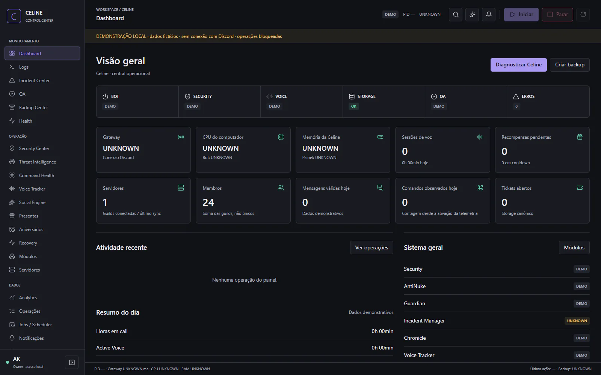

# Celine — Discord Automation & Recovery

Discord communities need coordinated moderation, recoverable state and tools for managing day-to-day operations. Celine combines community automation with server protection and a local management interface.

**Documentation-only engineering case study. Source code remains proprietary.**

## What was developed

- Command routing and permission-aware interactions.
- AntiNuke protection, incident handling, backups and recovery/rollback workflows are present in the private implementation. Their operational policies remain private.
- Voice activity, XP, community automation and a bounded dice-expression parser.
- Local Control Center for status, diagnostics and controlled operations.
- Locale resources for Portuguese, English and Spanish; complete translation coverage has not been established.

## Technology and technical decisions

JavaScript, Node.js 24, discord.js 14, CommonJS modules, JSON persistence, node:test/assert, HTML/CSS/JavaScript for the local Control Center. A Windows launcher uses C#; the panel is not an Electron or React application.

Recoverable file writes and controlled shutdown address interrupted operations. Explicit permissions separate a visible UI action from authority to perform it. A parser evaluates bounded dice expressions instead of executing user-supplied JavaScript.

## Validation

Recorded local verification from **October 29, 2026** (earlier runs, reviewed for this package):

| Check | Result |
|---|---|
| Command routing | PASS |
| Storage recovery | PASS |
| Shutdown coordination | PASS |
| Dice parser | PASS; harness reports 48 principal syntaxes |
| Security/RPG mode | PASS |
| npm dependency audit | 0 reported vulnerabilities |

Tests describe the exercised paths, not production usage or complete security coverage.

## Interface

Approved local Control Center renderer with synthetic data and operations disabled. This is a demonstration of the interface, not evidence of an active Discord connection.

## Development role

Portfolio owner and developer: **Studio Dev (@Studiodev00)**, as identified by the owner of this project. This case study presents implementation and verification evidence. It does not attribute every module exclusively to one person or establish employment, team size or business results from commit history.

## Current boundaries

Earlier local validation ran five selected harnesses; this is not a complete bot regression, live Discord exercise or penetration test. No coverage percentage, uptime, user count or universal rollback guarantee is claimed. JSON persistence is not a distributed database.

## Source and demonstration availability

This repository contains selected documentation and images only. It is not a buildable source distribution and grants no license to the private application. No binaries, production data or credentials are included. Screenshots appear in the Interface section; a supervised demonstration can be discussed with the project owner. No public application demo has been confirmed for this snapshot.

[Architecture](docs/ARCHITECTURE.md) · [Verified features](docs/FEATURES.md) · [Testing](docs/TESTING.md) · [Security](docs/SECURITY.md) · [Publication review](PUBLICATION_REVIEW.md)

Existing public policy repository: [celine-docs](https://github.com/Studiodev00/celine-docs). It is separate from this bot showcase and was not modified.

No project source code may be uploaded to GitHub, publicly or privately. Only explicitly approved documentation and authorized images are eligible for publication.
